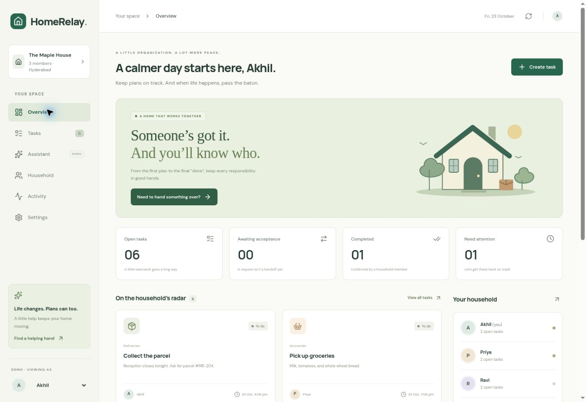
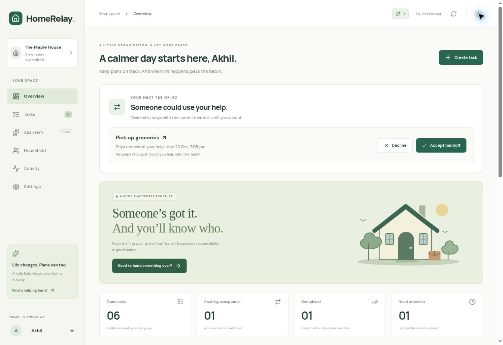
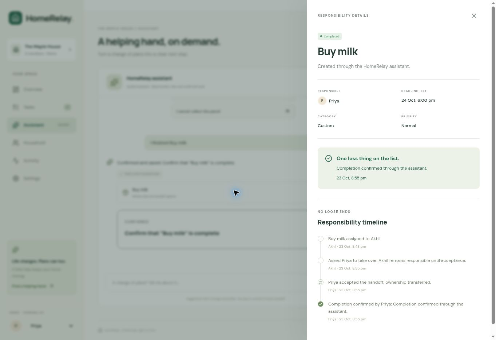

# HomeRelay

**A little help, right on time.** A household task coordinator for the moment an everyday plan falls through.

Create a responsibility, find an available replacement, explicitly request help, wait for acceptance, and record completion. A request never silently changes the owner.

Independent simulated Alexa+ experience for the Amazon Build, Ship, Shape hackathon. No Amazon affiliation or Alexa device connection is claimed.





## What works

- Persistent task creation, editing, cancellation, and member-confirmed completion.
- Candidate ranking from entered availability, category preference, open workload, and previous declines.
- Explicit request → accept/decline → completion with a responsibility timeline.
- Incoming handoff inbox with direct accept/decline controls and a request counter.
- Withdraw requests; editing task details withdraws pending invitations so recipients cannot accept old instructions.
- Retry-safe task creation with idempotency keys, and automatic refresh while browsing.
- Server checks for permissions, expiry, stale versions, duplicate completion, and changed availability.
- Dashboard, searchable task list/board, filters, assistant, household availability, activity, theme settings, and confirmed demo reset.
- Real shared households with account-bound membership, hashed single-use invitations, revocation, and a separate demo space.
- Recovery desk for overdue, soon-due, and unaccepted responsibilities, with recorded outcome and workload counts.
- Guided assistant previews for creation, handoff, acceptance, decline, and completion; server-side confirmation, expiry, and duplicate protection.
- Member-editable availability and category preferences.
- Browser alerts while open and downloadable calendar deadlines with reminders.
- Three labelled demo roles: Akhil, Priya, Ravi.
- Eleven MCP tools using the same business logic as the web API.
- Callable connection diagnostics at `/diagnostics`.
- Stored assistant conversations, task clarification, and confirmed actions. Guided rules work without a paid model.

## Implementation choice

The original brief suggested FastAPI/SQLite and React/Vite. This deployable edition uses **React 19, TypeScript, Vinext/Vite, a Cloudflare Worker backend, and persistent D1 (SQLite)** because Sites hosts Workers rather than Python servers. There is one deployable app and one shared business layer; no dummy Python server is included.

Every signed-in visitor has an isolated practice household and can create or join one shared household. D1 membership rows bind each account to one member; invitation hashes expire after 24 hours and are consumed atomically. Each household remains a versioned JSON aggregate. Compare-and-swap commits task, handoff, and activity changes together.

## Windows PowerShell setup

Install Node.js 24 LTS and Git first. From a new terminal:

```powershell
git clone https://github.com/akhilramb/HomeRelay.git
cd HomeRelay
corepack enable
corepack pnpm install --frozen-lockfile
corepack pnpm build
corepack pnpm db:migrate
corepack pnpm dev
```

Open the local URL printed by the dev command (normally `http://localhost:5173`). Local development uses the fictional household without paid services. Run `db:migrate` after pulling schema changes. It tracks applied local migrations and recognizes legacy local databases without recreating their tables. Keep `.wrangler/state` to preserve data across restarts.

If Corepack is unavailable, install pnpm from its official distribution, then replace `corepack pnpm` with `pnpm` in these commands. The pinned package manager version is in `package.json`.

The retained starter automatically selects the portable profile outside the managed Sites environment. All required scripts are included. The same app serves the frontend, API, and MCP endpoint; there are no separate Python or frontend terminals.

## Tests

```powershell
corepack pnpm test
corepack pnpm typecheck
corepack pnpm build
```

With your local development server running, optional HTTP integration tests use a disposable local test household. **Run only locally**, not against real hosted accounts:

```powershell
$env:TEST_ORIGIN = "http://localhost:5173"
corepack pnpm test:http
```

Open `/diagnostics` and click **Run connection checks** for database health, MCP discovery, initialization, tool invocation, and validation checks. See [actual validation results](docs/testing.md).

## Demo in 90 seconds

1. View as Akhil and open **Collect the parcel**.
2. Click **Find a helping hand**. Review Priya’s availability/workload explanation.
3. Click **Request help from Priya**. The owner stays Akhil.
4. Close details and switch the demo role to Priya.
5. Open the task; click **Accept handoff**. Ownership changes to Priya.
6. Add a completion note and click **Mark completed**.
7. Show the responsibility timeline. Reload and confirm the saved result.

Alternatively, start in Assistant with “I cannot collect the parcel”; review its preview and click Confirm action to send the handoff.

## Assistant modes and real households

The in-app **Guided assistant** uses transparent rules to interpret common requests. Try “Create task: Buy milk tomorrow at 6 pm”, “I cannot collect the parcel”, “Accept collect the parcel”, or “I finished collect the parcel”. Ambiguous task names produce a choice. Every mutation is previewed and requires **Confirm action**. Confirmations expire after ten minutes and recheck membership, task version, availability, and request state.

Optional server-only `AI_API_KEY`, `AI_BASE_URL`, and `AI_MODEL` enable an OpenAI-compatible language-model intent planner. It can propose a supported intent and task/member identifiers; it cannot directly mutate state or select arbitrary server commands. Invalid/failing provider output falls back visibly to guided rules. No real provider credential is configured on the published instance; mocked provider tests do not establish live-provider performance.

The connected HomeRelay MCP plugin also lets a model client such as ChatGPT call real household tools. This is distinct from the in-app guided assistant. A visitor needs an authenticated connection; public website access alone does not grant household access.

To use real members: sign in → Household → Create a household → Generate one-use invite. Send the website and code yourself. The recipient signs in with their own account → Household → Join with a code. Set availability and preferences before handoffs. A code grants access to household tasks and history, expires in 24 hours, and can be revoked or replaced by the creator. Shared mode disables role switching; practice data stays separate.

Browser alerts require browser permission and an open app. Calendar export creates an `.ics` snapshot with 30-minute reminders; it does not sync later edits or promise delivery by the calendar provider.

## MCP

Endpoint: `POST /mcp`. Supports stateless JSON-RPC discovery, initialization for 2025-11-25 and 2026-07-28, tool listing, tool calls, ping, and notifications. The Sites integration also discovers tools with `server/discover`.

Tools: `list_tasks`, `get_task`, `create_task`, `update_task`, `get_household_availability`, `suggest_handoff_candidates`, `request_handoff`, `withdraw_handoff`, `respond_to_handoff`, `complete_task`, `get_task_history`.

The server uses a small direct protocol handler rather than an MCP SDK. Discovery, initialization, and actual tool execution were tested; a full external-client conformance suite has not been run. See [MCP details](docs/mcp.md).

## Source map

| Feature | Files |
| --- | --- |
| App screens and navigation | `app/page.tsx` |
| Incoming handoff inbox | `app/components/HandoffInbox.tsx` |
| Input validation | `lib/homerelay/validation.mjs` |
| Editable task form | `app/components/TaskForm.tsx` |
| Original vector illustration | `app/components/HouseArt.tsx` |
| Design tokens and responsive styles | `app/globals.css` |
| Client API and IST dates | `lib/homerelay/client.ts` |
| Domain types | `lib/homerelay/types.ts` |
| State transitions and candidate rules | `lib/homerelay/service.mjs` |
| D1 persistence, identity, atomic updates | `lib/homerelay/store.ts` |
| Assistant planning and confirmation | `lib/homerelay/assistant.mjs` |
| Shared membership and invitations | `lib/homerelay/households.mjs` |
| Recovery metrics and calendar | `lib/homerelay/insights.mjs`, `lib/homerelay/calendar.mjs` |
| Web API | `app/api/relay/route.ts` |
| MCP schemas and transport | `lib/homerelay/tools.mjs`, `app/mcp/route.ts` |
| Database schema and migration | `db/schema.ts`, `drizzle/` |
| Health and connection tests | `app/api/health/route.ts`, `app/diagnostics/page.tsx` |
| Automated tests | `tests/` |

## Honest boundaries

Demo member switching is role simulation; shared mode uses real signed-in identities. Availability is manually entered. No Alexa device, SMS/email delivery, background push, purchases, or independent completion evidence is connected. Calendar export is a snapshot. Public visitors can reach the app, but household operations require sign-in. Live multi-account hosted onboarding and a live model provider still require end-user validation. No invented impact metrics or guaranteed judging scores are claimed.

See [architecture](docs/architecture.md), [API](docs/api.md), [limitations](docs/limitations.md), [demo script](docs/demo-script.md), and [submission draft](docs/hackathon-submission.md).

## License

HomeRelay-authored code is MIT licensed. Retained starter and vendored package licenses remain applicable; see `vendor/` and notices in `scripts/vite/`.

## Confirmed assistant workflow


